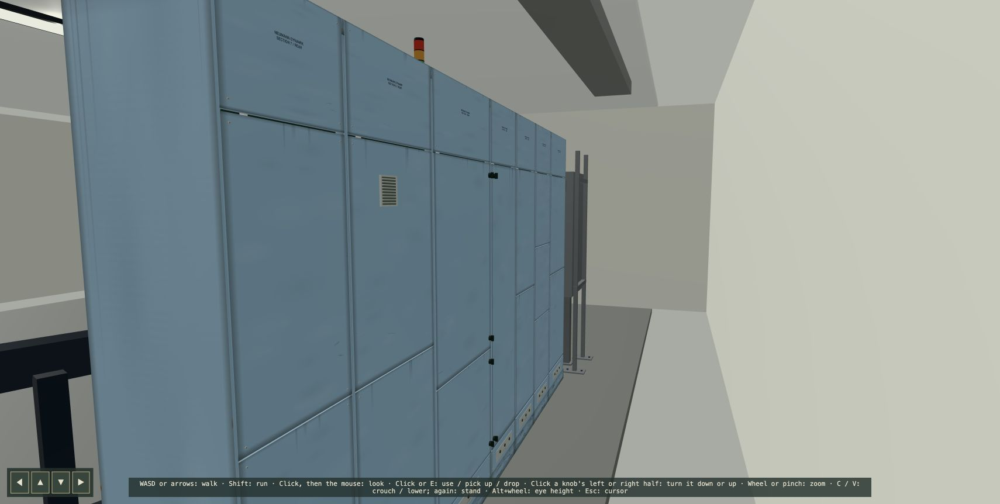
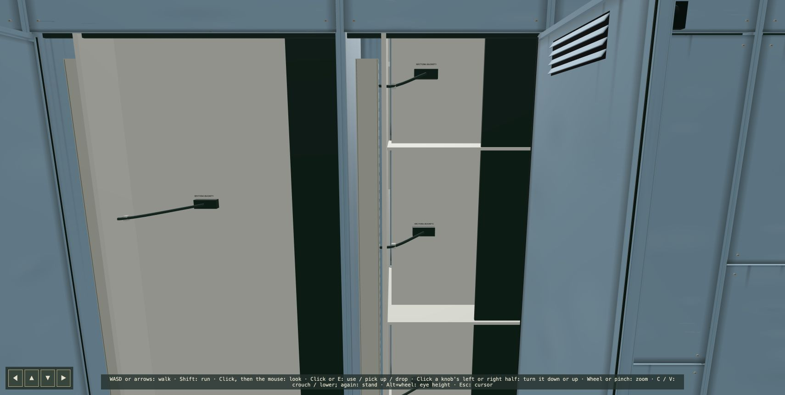

# Encabulator cabinet backs: return-path report

## 18 October 2026 — Research and planning complete

Prepared [the implementation plan](../plans/encabulator-cabinet-backs.md), [research notes](../research/encabulator-cabinet-backs.md) and [reference pack](../../resources/reference/encabulator-cabinet-backs/README.md) for the owner to review and the next implementing agent to use. The pack includes eleven individual manufacturer/period pictures and diagrams plus an eight-image contact sheet, all with source attribution. Inspected the rendered contact sheet and the rear-panel instruction page visually.

Recommended rear layout: five chiefly fixed/vented sections, rear service access in sections 4 and 5, three rear door leaves total, all initially closed. Research identifies the continuous outer rear sheet, inner bucket backplates, existing bus locations and front-only culling as the principal integration constraints. The plan preserves component identities, front-door indices, removal guards and Level 2 front-door narrative bindings.

Outstanding implementation choices: exact connector families, cable diameters and door swing clearances require measurement against the current model; the compact fan is a visual reference, not a completed cooling calculation. No game geometry, electrical wiring, interactions or runtime assets were changed for this research task. Runtime tests/build were not required for the documentation and reference-image additions. Image licences have not been cleared for game use; this is a credited research pack only.

Next reader: owner, then the agent executing [the original prompt](../prompts/encabulator-cabinet-backs.md). Preserve this entry and append dated implementation/review notes, validation, limitations and unresolved blockers here on subsequent runs.

## 18 October 2026 — Implementation

Implemented the [plan](../plans/encabulator-cabinet-backs.md) in `src/scene/encabulator-rear.ts`, assembled by the existing MCC factory. All three consumers (dev6, Level0 and Level2) use it without forks. The old continuous outer sheet is removed. Seven independently fitted rear sections retain the original 4.064 m width, 508 mm depth and 2.286 m body height above the 100 mm plinth. Fixed sections are 1, 2, 3, 6 and 7. Section 4 has one service leaf; section 5 has automation and termination leaves split at its actual 8/4-space bucket boundary. All start closed. Section 6 has guarded low/high 116.5 mm filter grilles.

Measured cross-section, front to rear: existing bucket mounting plate centred at z = −0.375 m (6 mm thick), connector housings near −0.389 m, closed duct occupying approximately −0.444 to −0.404 m, original copper near −0.43/−0.4 m within protected routes, added bus guards near −0.474/−0.464 m, and outer rear plane −0.509 m. The top fixed/guarded zone now begins about 365–370 mm below the roof, covering the lowest of the three existing horizontal phases as well as the upper two. The mounting plates remain opaque; rear access does not expose counterfeit board fronts or allow card removal through steel.

### Route schedule

| Endpoint identity  | Purpose                             | Route / support                                                                                               | Access               |
| ------------------ | ----------------------------------- | ------------------------------------------------------------------------------------------------------------- | -------------------- |
| `section4.bucket1` | Encabulator control rear plate feed | 8 mm loom from closed CD 60×40 duct to labelled plate connector; two clips                                    | Section 4 rear leaf  |
| `section4.bucket2` | Modial interaction rear plate feed  | Same supported edge-to-plate route at the actual bucket height                                                | Section 4 rear leaf  |
| `section4.bucket3` | Phase reference rear plate feed     | Same route at the actual bucket height                                                                        | Section 4 rear leaf  |
| `section4.bucket4` | Panendermic monitor rear plate feed | Same route at the actual bucket height                                                                        | Section 4 rear leaf  |
| `section5.bucket1` | Automation rear plate I/O feed      | Supported loom and covered vertical duct; original PLC chassis/cards remain behind their mounting structure   | Section 5 upper leaf |
| `section5.bucket2` | Field termination rear plate feed   | Supported loom and covered vertical duct at the actual termination bucket                                     | Section 5 lower leaf |
| Three rear leaves  | Protective bonding                  | Flexible 5 mm green/yellow leads between fixed chassis and moving leaf studs, with slack following each hinge | Own rear leaf        |
| Lower entry zones  | Reserved machine-circuit entries    | Segmented labelled plates with blanked ports; existing isolator/base/side trunking preserved                  | Fixed covers         |

The route schedule is appearance metadata (`mcc.rear.routes`), not another electrical graph. Unmodelled external motors/loads are deliberately not supplied with dangling decorative cables. Power bus routing stays separately guarded; no bare power conductors cross the signal service areas. The BBC-to-machine data cable is absent, at the owner's request, pending a later diagnostic-interface task.

### Components, interaction and viewing

Reusable geometry is in `industrial-control/views/cabinet-rear-fittings.ts`; the service leaf in `industrial-control/parts/cabinet-service-door.ts` composes the existing shared door latch/back components and sounds. Catalogue references and construction are recorded in the [research](../research/encabulator-cabinet-backs.md) and `CREDITS.md`. The full set is on dev0's new CABINET REAR FITTINGS board, east wall, `?room=dev0&view=rear`: working service leaf, fixed folded sheet, CD 60×40 duct, filter, entry plate and bonding lead, all at true size. Passive fittings have no artificial controls.

Use either black fastener to open/close a rear leaf; its inside cover also closes it. Opening rear access leaves front-door signals, component identities, isolation, board attachment and narrative triggers unchanged. Existing front interiors render for front access OR corresponding rear access OR their always-render policy, and remain visible through closing motion. Rear-only dressing is separately culled and pruned from raycasting. Labels retain non-pickable behaviour when static geometry is merged.

Inspect `?room=dev6&view=rearOverview` (closed), `?room=dev6&view=rear&rear=open` (service detail), or `?room=dev6&view=rearOverview&rear=open` (open oblique). The `rear=open` preview is development-only; ordinary starts remain closed. Dev6 depth was increased from 10 to 12 m for the rear walking aisle and full leaf swings; Level0/Level2 machine placement is unchanged. Existing front-door development indices remain intact; `devEncabulator.rearDoor(index)` controls rear leaves separately.

### Validation and limits

Tests exercise both fasteners, inside-cover closure, independent front/rear states, unchanged breaker state, bucket rendering through either access/closing animations, opaque rear plates and raycast pruning. Existing startup/shutdown, board removal/reseat, PLC-window culling, portal and Level2 narrative tests remain part of the full suite. The fan/filter is a dimensional appearance reference, not a new thermal model. Rear connectors represent mounting-plate feeds; component-specific front-mounted electronics remain on their original service side. Glands for future external loads and the BBC diagnostic interface remain blanked/reserved rather than introducing unimplemented wiring or fake operating states.

The six control looms pass through actual cut-outs in the existing control/automation wireway partitions, with rubber edge trim. Their slot positions follow the same bucket coordinates as the supported looms; a raycast test verifies that the openings are holes in the sheet rather than black rectangles over solid steel. This preserves the original compartment partitions around the routes. The partition fitting is also on the dev0 board.

All five required checks passed: typecheck, lint, formatting check, all 627 tests across 83 files, and production build. Browser inspection covered the closed oblique rear, open service plates/guards and the dev0 fittings board. At the same dev6 oblique inspection viewpoint, the entire rendered frame measured 3,420 calls / 61,400 triangles with rear dressing hidden, 3,486 / 71,656 closed, and 4,221 / 93,672 with rear leaves open. The hidden case is a dressing-cost baseline, not the former continuous-sheet model; open access also renders the genuine affected bucket interiors. Static fittings are merged by shared material, while working leaves/fasteners and labels retain their identities. This does not attempt a wider optimisation of the existing MCC.

## 18 October 2026 — Approved BBC data entry

The owner subsequently authorized the BBC data cable. The right-hand low round entry in section 1 is now a labelled DATA gland, replacing its blanking cap. `mcc.rear.dataPort` supplies the real transform to the shared workstation arrangement, so the cable reaches the same geometry at any scene scale. The serial lead drops from the BBC rear, follows a rubber floor protector behind the isolator, and rises into that gland. The other entries remain blanked. The protector sits 1 mm above the floor as requested. This updates the earlier physical-cable deferral; live annunciator diagnostics remain planning-only.
