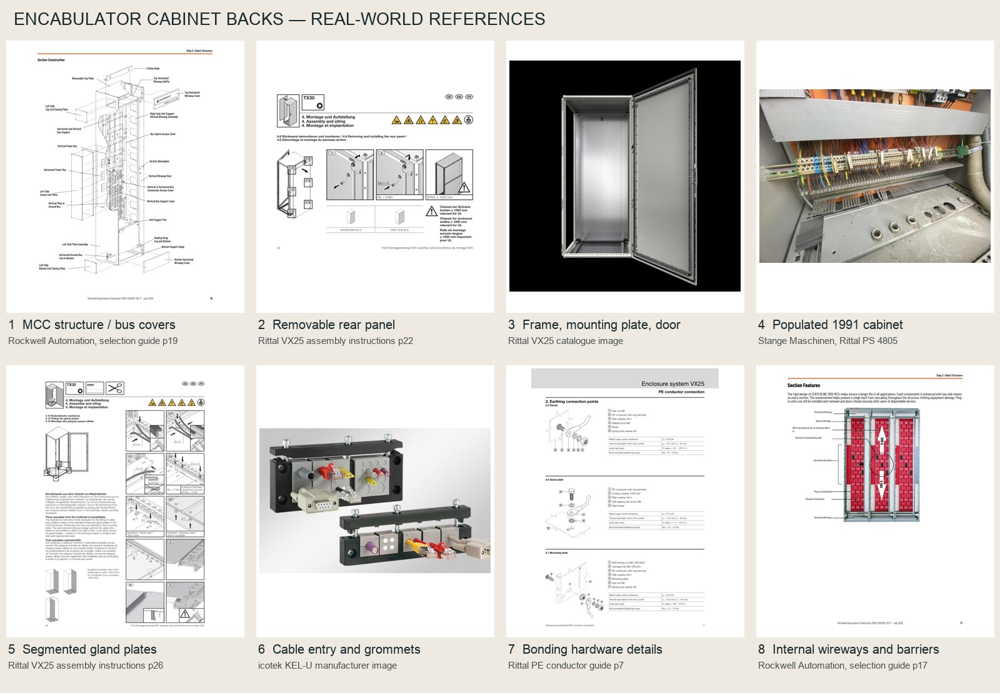

# Encabulator cabinet backs: research

Researched 18 October 2026 for [the cabinet-back prompt](../prompts/encabulator-cabinet-backs.md). The proposed design is in [the implementation plan](../plans/encabulator-cabinet-backs.md). This is visual and construction research for a fictional game model, not an electrical installation specification or certification claim.

## Reference pictures

The [reference pack](../../resources/reference/encabulator-cabinet-backs/README.md) has individual full-resolution pictures, source URLs, page numbers, attribution and reuse notes. The board includes manufacturer illustrations as well as photographs; it does not claim that a front view is a photograph of a rear elevation.

## Findings from manufacturers

**Rockwell CENTERLINE 2100:** the [selection guide](https://literature.rockwellautomation.com/idc/groups/literature/documents/sg/2100-sg003_-en-p.pdf), printed pages 16–21, distinguishes front-mounted and back-to-back arrangements. Back-to-back means two equipment sections, not ordinary front equipment exposed through an open back. Page 19's exploded illustration separates the support pans, bus covers, wireways and structural panels. Top and bottom wireways are 152.4 mm high; barriers separate cable routes and power buswork. Pages 17–19 are saved locally. Use this source for the machine's underlying MCC construction, retaining covered power areas. Its normal interior finish also includes light-painted mounting surfaces; bare zinc is not universal.

**Rittal VX25 enclosure:** the [VX 8685.000 product specification](https://www.rittal.com/uk-en/products/PG20231215SCH101/PG20240111SCH301/PRO70035?variantId=8685000) identifies separate rear, roof, mounting and gland plates. Its reference sheet steel is 1.5 mm for the rear panel, 2 mm for the door and 3 mm for the mounting plate. These are construction references, not a reason to resize our machine to a VX25 enclosure. The [assembly instructions](https://www.rittal.com/imf/none/3_11523/8685000_Instructions_DE_EN_FR), page 22, show the screwed rear panel and its mounting details; page 26 illustrates segmented bottom cable-entry plates. A rear panel is distinct from the internal equipment mounting plate. The saved open-enclosure photograph makes this distinction particularly clear.

**Bonding:** Rittal's [protective-conductor documentation](https://www.rittal.com/imf/none/3_6978/8685000_Protective_conductor_brochure_EN), page 7, illustrates panel studs, ring terminals and gland/mounting-plate connections. Page 12 also explains that VX25 can obtain panel bonding through its designed mechanical joints. Therefore visible green/yellow straps are a deliberate readable detail for our fictional older machine, not a claim that every modern Rittal panel requires a separate loose earth wire. Use proper-looking lugs and attachment points, with slack only where a panel actually moves.

**Cable entry:** [icotek KEL-U/KEL-E](https://www.icotek.com/en/products/cable-entry-systems/kel-u-42250) uses split grommets in a rigid frame, supporting cables with existing connectors and providing sealing/strain relief. The saved manufacturer picture shows the assembled and open frame. This is a useful pattern for grouped automation/signal cables; individual heavier cables can use appropriately sized glands. Do not model plain rubber grommets as if they alone clamp a heavy cable.

**Wiring duct:** Phoenix Contact [CD 60X40, 3240190](https://www.phoenixcontact.com/de-lu/produkte/verdrahtungskanal-cd-60x40-3240190) is a real slotted cabinet duct with lid, 60 mm wide and 40 mm high, supplied in 2 m lengths. Use its cross-section at true size, cut to the needed route, rather than scaling a generic box. Closed lids can conceal most conductors, leaving short, readable branches to real terminals.

**Ventilation:** Rittal [SK 3237.100](https://www.rittal.com/pdf-creator/variant/lt-en/3237100) is a compact fan/filter reference: a 116.5 mm square face and 43 mm installation depth; the [dimension drawing](https://www.rittal.com/imf/none/3_2900/3243100_Technical_details_EN/) identifies a 92 mm square cut-out. Use it as a visual size reference for a paired intake/exhaust arrangement, not as a verified thermal sizing choice for our drive. A grille should reveal a filter or fan, not an unrestricted hole into copper buswork.

## Period visual reference

The [Stange Maschinen listing for a Rittal PS 4805](https://shop.stange-maschinen.de/Standardschaltschrank-Schaltschrank-Steuerschrank-Einzelschrank/P62265) identifies a 1991 cabinet. Its saved photograph shows terminal rows, dense but organized wiring, ducting and a substantial gland plate. Use the photograph for age, density and workmanship; it shows a populated cabinet interior, not evidence of a particular rear-access design. Manufacturer documents above provide the construction basis.

## What the existing model permits

At research time, `src/scene/retro-encabulator-mcc.ts` builds seven sections, 4.064 m total width, 2.286 m body height above the 100 mm plinth and 508 mm depth. Section widths, from the front's left, are 635, 508, 508, 508, 762, 635 and 508 mm. The rear is at local z = −0.508 m. A single 12 mm-thick sheet currently closes the entire lineup there.

Each bucket also has a 6 mm inner liner near local z = −0.375 m. Its nominal separation from the outside back is only about 133 mm, before allowing for hardware and buswork. Existing horizontal copper bars lie near z = −0.43 m and vertical bars near z = −0.4 m. An opening in the outside sheet would therefore expose liners or buswork, not conveniently reveal component faces. The model needs purposeful rear service spaces and guards; deleting all rear-facing surfaces would be physically misleading.

Front access currently controls each bucket's `interior.visible` state. Rear access must participate in that visibility calculation without operating front-door signals or changing the machine's electrical state. Board removals, isolation checks and the narrative's automation-door trigger depend on existing component/door identities and must keep them.

## Design conclusion

Recommend five principally closed rear sections and two hinged service sections: section 4 (control/instruments) and section 5 (automation/field terminations). All rear doors start closed. Once open, show real chassis backs, mounting surfaces and wiring connections. Most front-mounted boards stay front-serviceable; a rear door is not a second card extraction slot. This arrangement is our fictional Neumann adaptation of the references, not a catalogued CENTERLINE option.

## Return path

Implementation and review feedback belongs in `doc/reports/encabulator-cabinet-backs.md`, for the owner and next implementing/reviewing agent. Create it if missing, preserve existing feedback and add dated entries on later runs. Record changes to the proposed layout, validation, limitations and unresolved questions there; link this research and the plan.
