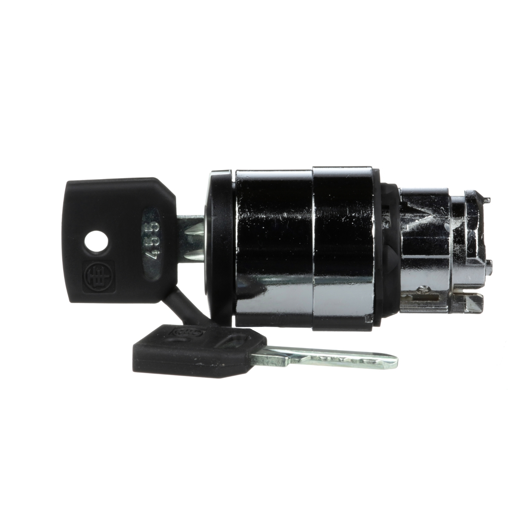

# Industrial key-switch heads

Researched 18 October 2026. Schneider's [ZB4BG2 manufacturer photograph](https://download.se.com/files?p_Doc_Ref=ZB4BG2_LEFT&p_File_Type=rendition_1500_jpg) shows the Ronis 455 key inserted and loose. Its bow is a broad flat black plate with chamfered/rounded corners, a circular keyring hole, identification and a narrow metal neck. The [Harmony XB4 specification](https://www.se.com/uk/en/product/XB4BG33/key-switch-selector-metal-black-%C3%B822-key-n455-3-positions-stay-put-2-no/) confirms the key family; the 22 mm dimension refers to operator mounting, not key size.

Eaton's [M22-ES-MS1 item 216416](https://www.eaton.com/us/en-us/skuPage.216416.html) lists a 48 × 22 × 3 mm overall key envelope and a STEP model, which was not retrievable during this session. Do not use those complete-key dimensions as measured Schneider bow dimensions.

Our `createLeverSelector` in `industrial-controls.ts` draws a brass blade and a 4 × 18 × 12 mm plain black box, then scales its outward depth to 30%, leaving only 3.6 mm of head length. `createKeySwitch` in `panel-switchgear.ts` also uses an unshaped box. Neither has a neck, shaped perimeter or keyring hole. A future correction should use a shared flat key mesh, a chamfered perimeter and hole, a silver neck and bevels, while preserving existing rotation/detents. Exact bow dimensions require a drawing or an explicitly labeled visual estimate. Research only: no key geometry changed yet.
